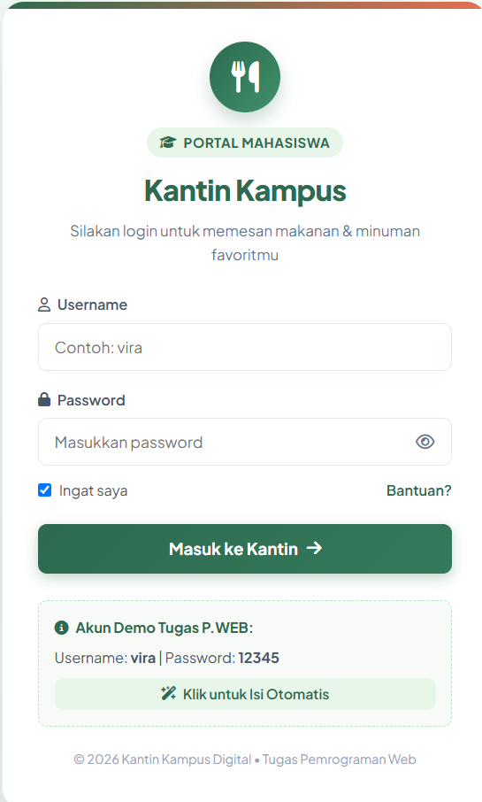
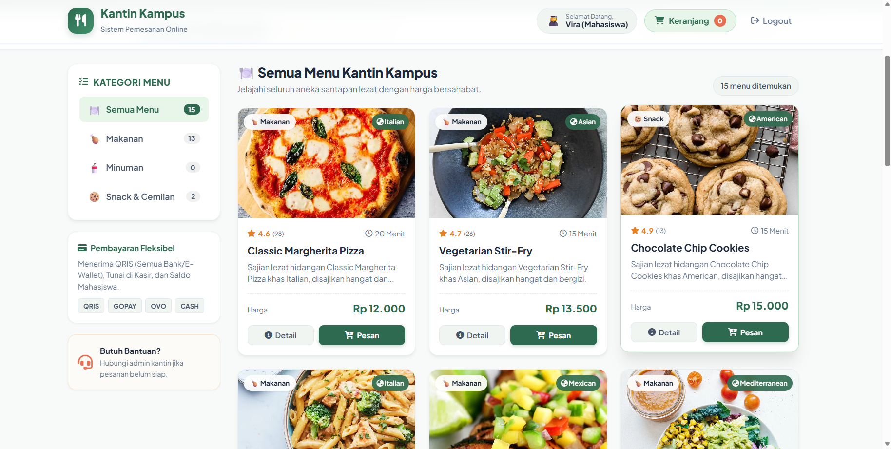
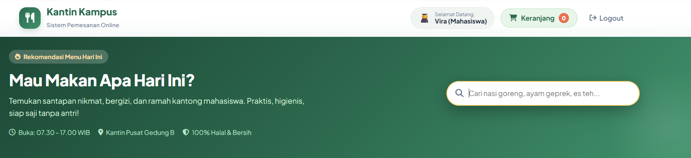
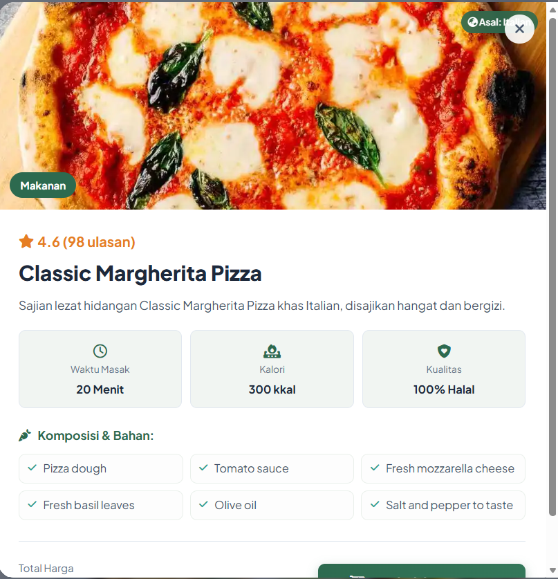
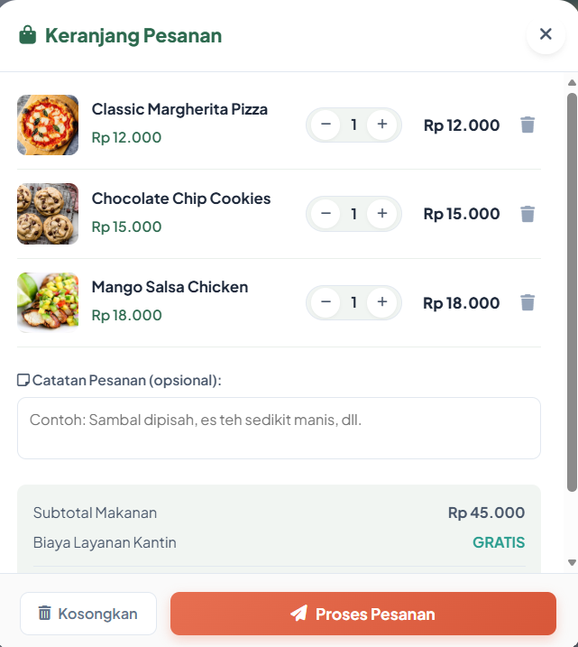

# 🍴 Kantin Kampus Digital - Sistem Pemesanan Menu Online
> **Tugas Praktikum Pemrograman Web (Semester 5)**  
> Implementasi Komprehensif: **HTML5, CSS3, JavaScript Modern (ES6+), dan REST API**

---

## 📋 Informasi Tugas
- **Mata Kuliah**: Pemrograman Web
- **Semester**: 5
- **Topik Tugas**: Penerapan HTML, CSS, JavaScript, dan Integrasi API

---

## 📸 Dokumentasi Screenshot Tampilan Aplikasi

Berikut adalah dokumentasi tangkapan layar (*screenshot*) antarmuka aplikasi Kantin Kampus:

### 1. Halaman Login Mahasiswa
Tampilan awal otentikasi pengguna dengan fitur intip password, validasi interaktif, dan tombol auto-fill akun demo.

---

### 2. Halaman Utama Katalog Menu
Tampilan daftar menu makanan dan minuman dengan desain grid modern, hero banner sapaan personal, dan badge informasi.

---

### 3. Fitur Filter Kategori, Live Search, & Data Switcher
Penyaringan menu berdasarkan kategori (*Semua, Makanan, Minuman, Snack*), pencarian cepat real-time, pengurutan harga/rating, serta switcher sumber data (API Online vs Menu Lokal).

---

### 4. Modal Detail Resep & Bahan Baku (Integrasi Data API)
Pop-up interaktif yang menampilkan komposisi bahan (*ingredients*), kalori, asal kuliner (*cuisine*), dan estimasi waktu masak yang diambil langsung dari data API.

---

### 5. Keranjang Belanja & Struk Antrean Digital (Checkout)
Drawer keranjang pesanan dengan kontrol kuantitas (+ / -), kalkulasi subtotal dan total otomatis, catatan khusus, serta nota antrean digital setelah proses pemesanan.

---

## 💡 Penerapan 4 Pilar Pemrograman Web

### 1. 📄 Penerapan HTML (HyperText Markup Language)
- Menggunakan struktur semantik HTML5 standar: `<header>`, `<nav>`, `<aside>`, `<main>`, `<article>`, `<section>`, dan `<footer>`.
- Elemen form lengkap pada login: `<form>`, `<input>`, `<label>`, `<button>`, serta atribut aksesibilitas (`required`, `autocomplete`, `novalidate`).
- Struktur dialog modal pop-up untuk detail menu, keranjang belanja, dan struk digital.

### 2. 🎨 Penerapan CSS (Cascading Style Sheets)
- **Design System & CSS Variables (`:root`)**: Pengaturan palet warna konsisten (*Emerald Green* `#2D6A4F` & *Warm Terracotta* `#E76F51`), border-radius, dan bayangan berlapis (*box-shadow*).
- **Modern Layouts**: Kombinasi **CSS Grid** (`repeat(auto-fill, minmax(260px, 1fr))`) untuk kartu produk dan **Flexbox** untuk komponen navbar, toolbar, kartu, dan keranjang.
- **Efek Visual & Animasi**: Hover lift effect pada kartu, transisi halus, backdrop-filter *glassmorphism*, badge counter berdenyut (*pulse*), dan notifikasi mengambang (*toast*).
- **Desain Responsif**: Media queries teruji untuk perangkat Desktop, Tablet, hingga Layar Smartphone (Mobile Friendly).

### 3. ⚡ Penerapan JavaScript (ES6+)
- **Manipulasi DOM Dinamis**: Pembuatan dan rendering elemen kartu menu, item keranjang belanja, modal detail, dan struk nota tanpa reload halaman.
- **Event Handling**: Menangani event `submit`, `click`, `input` (live search), `change` (sorting), dan delegasi event (*event delegation*).
- **Manajemen Sesi & State (LocalStorage)**: Menyimpan sesi login pengguna (`kantinUser`) dan data keranjang belanja (`kantinCart`) agar tidak hilang saat halaman di-refresh.
- **Array Methods**: Pemanfaatan method modern JavaScript seperti `.map()`, `.filter()`, `.reduce()`, `.find()`, dan `.sort()`.

### 4. 🌐 Penerapan REST API & Asynchronous Programming
- **Fetch API & Async/Await**: Mengambil data resep makanan secara asinkron dari *DummyJSON Recipes API* (`https://dummyjson.com/recipes`).
- **Error Handling & Loading State**: Menampilkan indikator loading animasi spinner dan penanganan `try...catch` yang rapi jika terjadi kendala jaringan.
- **Dual Source Data & Fail-Safe Fallback**:
  - Pilihan sumber data: **🌐 API Online (DummyJSON)** dan **📂 Menu Lokal (menu.json)**.
  - Dilengkapi sistem cadangan otomatis terintegrasi sehingga aplikasi tetap berjalan lancar tanpa blank meskipun perangkat sedang offline/tanpa internet.

---

## 🔑 Kredensial Akun Pengujian

Gunakan akun demo berikut untuk masuk ke sistem:
- **Username**: `vira`
- **Password**: `12345`
*(Tersedia tombol auto-fill di halaman login untuk kemudahan penilaian)*

&copy; 2026 Kantin Kampus Digital • Tugas Pemrograman Web Semester 5
